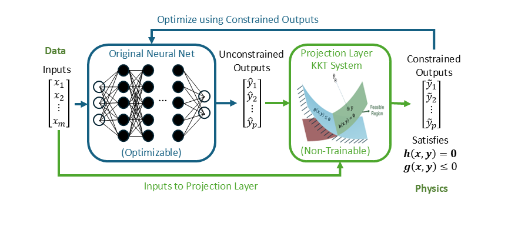

# KKT-HardNet

**Learn surrogate, inverse and optimization models with hard constraint projections in JAX.**

[](https://github.com/SOULS-TAMU/kkt-hardnet/actions/workflows/ci.yml?query=branch%3Amain)
[](https://github.com/SOULS-TAMU/kkt-hardnet/actions/workflows/validation.yml?query=branch%3Amain)
[](https://github.com/SOULS-TAMU/kkt-hardnet/actions/workflows/codeql.yml?query=branch%3Amain)
[](https://github.com/SOULS-TAMU/kkt-hardnet/actions/workflows/dependency-review.yml?query=branch%3Amain)
[](https://github.com/SOULS-TAMU/kkt-hardnet/tree/codex/coverage-main)

[](https://github.com/SOULS-TAMU/kkt-hardnet/blob/main/.github/workflows/release.yml)
[](https://github.com/SOULS-TAMU/kkt-hardnet/blob/main/.github/workflows/ci.yml)
[](https://docs.jax.dev/)
[](https://github.com/SOULS-TAMU/kkt-hardnet/blob/main/LICENSE)
[](https://github.com/SOULS-TAMU/kkt-hardnet/blob/main/CITATION.bib)

Define parameters, variables, constraints and a learning task through a compact
frontend. OHAGI supplies one shared training and inference engine; PURIN supplies
the projection algorithms that enforce the declared constraints.



- **Three tasks:** constrained surrogate modeling, inverse parameter estimation
  and unsupervised optimization.
- **Differentiable projections:** affine and smooth nonlinear equalities,
  inequalities and bounds, using the appropriate PURIN solver.
- **Flexible backbones:** functional JAX networks, custom adapters and optional Flax.
- **Reusable deployment:** export once, load from `metadata.json`, and predict repeatedly.

[Installation](#installation) · [Basic API](#basic-api) · [Load and predict](#load-and-predict) · [Documentation](#documentation) · [Contributing](#contributing) · [Citation](#citation)

## Installation

Requires **Python 3.10 or newer**. Install from PyPI:

```shell
python -m pip install kkt-hardnet
```

The distribution name is `kkt-hardnet`; the Python import is `kkthn`.
For editable installs and optional Flax/Orbax integrations, see
[installation options](https://github.com/SOULS-TAMU/kkt-hardnet/blob/main/docs/INSTALL.md).

## Basic API

### Constrained surrogate

This self-contained example creates a small CSV and learns two nonnegative
outputs whose sum matches the input parameter:

```python
from pathlib import Path
import numpy as np
from kkthn import KKTHardNet

p_values = np.linspace(0.4, 1.2, 8)
data = Path("data.csv")
np.savetxt(data, np.column_stack((p_values, 0.6*p_values, 0.4*p_values)),
           delimiter=",", header="p,u,v", comments="")

model = KKTHardNet(name="sum_model", train={
    "epochs": 2, "batch_size": 2, "seed": 7,
    "pretrain": False, "print_every": 0,
})
p = model.add_parameter(["p"])
y = model.add_variable(["u", "v"])
model.constraints.add(y.u + y.v == p.p, y.u >= 0, y.v >= 0)
model.dataset(parameters=data, variables=data)
result = model.model()
prediction = model.predict([0.7])
```

### Choose a learning task

| Task | Data / definition | Entry point |
| --- | --- | --- |
| Surrogate modeling | Parameters and observed variables | `model.model()` |
| Unsupervised optimization | Parameters and a symbolic objective | `model.optimize()` |
| Inverse estimation | Observations and unknown coefficients | `model.estimate()` |

Select `type="optimization"` or `type="parameter_estimation"` when constructing
those tasks. See [problem definitions](https://github.com/SOULS-TAMU/kkt-hardnet/blob/main/docs/PROBLEM.md) for current observation-loss,
unknown-variable, backbone and projection interfaces.

## Load and predict

Reload a trained full model and export its deployment bundle:

```python
model = KKTHardNet().load(result["metadata_path"])
prediction = model.predict([0.7])
model.export_inference("deployment/metadata.json")
```

The same deployment bundle also works through OHAGI:

```python
from ohagi.inference import load

predictor = load("deployment/metadata.json")
for value in [0.4, 0.7, 1.0]:
    prediction = predictor.predict([value])
```

Keep the referenced `.jax_export` file with `metadata.json`. Load once and reuse
the predictor. `predict` returns synchronized NumPy values; `predict_jax` keeps
outputs on the JAX device. Deployment uses the shared JAX pathway.

## Data convention

CSV headers match the declared parameter and variable names. Surrogate and
inverse tasks use parameter and variable observations; optimization uses
parameter observations. A single CSV may contain both sets of columns.

## The HardNet stack

- **[KKTHN](https://github.com/SOULS-TAMU/kkt-hardnet/tree/main),
  [DAEHN](https://github.com/SOULS-TAMU/dae-hardnet/tree/main) and
  [NLPOPTNet](https://github.com/SOULS-TAMU/nlpoptnet)** supply problem formulations
  and framework-specific processing.
- **[OHAGI](https://github.com/SOULS-TAMU/Ohagi/tree/development)** composes models,
  runs the shared learning engine, and handles checkpoints and JAX deployment.
- **[PURIN](https://github.com/SOULS-TAMU/Purin/tree/development)** owns projection
  problems, numerical solvers, sparse kernels and projection differentiation.

## Compatibility and validation

The PyPI CPU installation matrix covers **Python 3.10–3.15** on Linux, Windows and macOS,
plus Linux ARM64 on Python 3.13. It uses current compatible JAX releases;
regular CI additionally tests JAX 0.6.2 on Python 3.12. See the [release workflow](https://github.com/SOULS-TAMU/kkt-hardnet/blob/main/.github/workflows/release.yml)
for exact environments; accelerator installation follows the
[JAX guide](https://docs.jax.dev/en/latest/installation.html).

- **CI:** tests, distribution builds and installation checks.
- **Validation:** public APIs, numerical references, documentation and code quality.
- **Coverage:** at least **90% combined statement and branch coverage**; the badge
  links to the measured report for this branch.
- **Security:** CodeQL analysis and dependency review.

The frontend validation policy also checks API compatibility, checkpoint resume,
types, dependency boundaries and cognitive complexity. See
[validation details](https://github.com/SOULS-TAMU/kkt-hardnet/blob/main/.github/validation/README.md).

## Documentation

**[Read the full documentation](https://kkthn.readthedocs.io/en/latest/)** — installation, tutorials, user guide and API reference.

The full Sphinx guide follows the Read the Docs style: [contents](https://github.com/SOULS-TAMU/kkt-hardnet/blob/main/docs/index.rst),
[runnable examples](https://github.com/SOULS-TAMU/kkt-hardnet/blob/main/docs/examples/index.rst), [API reference](https://github.com/SOULS-TAMU/kkt-hardnet/blob/main/docs/api/index.rst)
and [build instructions](https://github.com/SOULS-TAMU/kkt-hardnet/blob/main/docs/BUILD.md).

| Guide | Contents |
| --- | --- |
| [Installation](https://github.com/SOULS-TAMU/kkt-hardnet/blob/main/docs/INSTALL.md) | Source installs, optional integrations and packaging |
| [Problem definitions](https://github.com/SOULS-TAMU/kkt-hardnet/blob/main/docs/PROBLEM.md) | Modeling, backbones and training |
| [Inference](https://github.com/SOULS-TAMU/kkt-hardnet/blob/main/docs/INFERENCE.md) | Export, loading and repeated prediction |
| [Version notes](https://github.com/SOULS-TAMU/kkt-hardnet/blob/main/docs/VERSION.md) | Current development behavior |
| [Changelog](https://github.com/SOULS-TAMU/kkt-hardnet/blob/main/CHANGELOG.md) | Recorded changes |

The independent KKTHN site above documents version 2.0.0. The previous
[kkt-hardnet site](https://kkt-hardnet.readthedocs.io/en/latest/) is maintained
separately; previous documentation sources are preserved in the
[v1.0.1 archive](https://github.com/SOULS-TAMU/kkt-hardnet/tree/v1.0.1/docs).

## Contributing

Bug reports, examples and focused pull requests are welcome. Read
[CONTRIBUTING.md](https://github.com/SOULS-TAMU/kkt-hardnet/blob/main/CONTRIBUTING.md) for setup, numerical checks and compatibility
requirements. Keep generated results, environments and checkpoints out of Git.

## Citation

Use [CITATION.bib](https://github.com/SOULS-TAMU/kkt-hardnet/blob/main/CITATION.bib) for a copyable BibTeX entry or GitHub's
**Cite this repository** menu for [citation metadata](https://github.com/SOULS-TAMU/kkt-hardnet/blob/main/CITATION.cff).
For the method, also cite
[Physics-informed neural networks with hard nonlinear equality and inequality constraints](https://doi.org/10.1016/j.compchemeng.2025.109418).

## License

[Apache License 2.0](https://github.com/SOULS-TAMU/kkt-hardnet/blob/main/LICENSE). Authorship and upstream attribution are recorded
in [AUTHORS](https://github.com/SOULS-TAMU/kkt-hardnet/blob/main/AUTHORS) and [NOTICE](https://github.com/SOULS-TAMU/kkt-hardnet/blob/main/NOTICE).

[Changelog](https://github.com/SOULS-TAMU/kkt-hardnet/blob/main/CHANGELOG.md) · [Report an issue](https://github.com/SOULS-TAMU/kkt-hardnet/issues)
