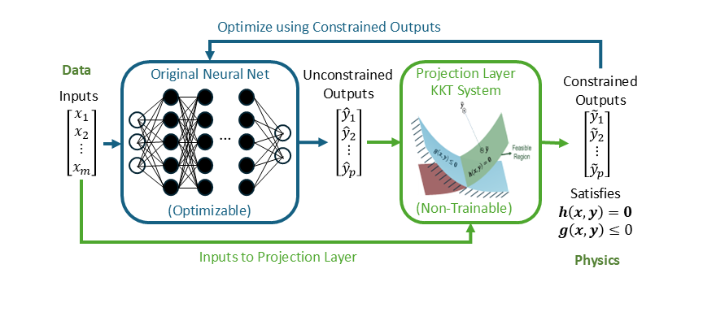

KKT-HardNet
===========

Constrained surrogate modeling, inverse estimation and optimization in JAX.

This guide describes version **2.0.0**. Start with the runnable example,
then use the guide and API reference for your own problem.

Quick overview
--------------

A neural network proposes an output, then the projection enforces the declared
constraints for the supplied problem parameters:

.. math::
   \widetilde y = \underset{y}{\operatorname{argmin}}\;\tfrac12\|y-\widehat y\|_2^2,
   \qquad h(x,y)=0,\quad g(x,y)\le 0.

Use ``model()`` for supervised learning, ``optimize()`` for an objective-driven
task, or ``estimate()`` with observed outputs for parameter estimation. Select
the task when constructing the model. Start with :doc:`examples/quickstart`.

.. toctree::
   :maxdepth: 2
   :caption: Start here

   INSTALL
   examples/index
   user-guide/index

.. toctree::
   :maxdepth: 2
   :caption: Reference

   api/index
   ECOSYSTEM
   MIGRATION
   citations
   license
   contributing
   changelog
   BUILD
   PUBLISHING

Indices and search
------------------

* :ref:`genindex`
* :ref:`modindex`
* :ref:`search`
